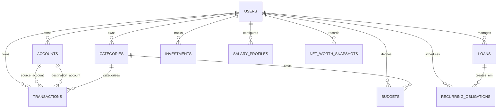

# Finora Database Schema & Constraint Specification

Finora uses an ACID-compliant relational model with foreign key enforcement (`PRAGMA foreign_keys = ON;`), WAL mode (`PRAGMA journal_mode = WAL;`), and strict data type constraints.

All monetary quantities are stored as **64-bit integer values representing paise** (`BIGINT` or `INTEGER` in SQLite).

---

## 1. Entity Relationship Diagram



---

## 2. Table Schemas & Invariants

### 2.1 `users`
Core user identity and configuration.
```sql
CREATE TABLE users (
    id TEXT PRIMARY KEY,                       -- UUID v4
    email TEXT UNIQUE NOT NULL,
    full_name TEXT NOT NULL,
    currency_code TEXT DEFAULT 'INR' NOT NULL, -- ISO-4217 code
    created_at DATETIME DEFAULT CURRENT_TIMESTAMP NOT NULL,
    updated_at DATETIME DEFAULT CURRENT_TIMESTAMP NOT NULL
);
CREATE INDEX idx_users_email ON users(email);
```

### 2.2 `accounts`
Financial containers representing liquid banks, wallets, credit lines, and liabilities.
```sql
CREATE TABLE accounts (
    id TEXT PRIMARY KEY,
    user_id TEXT NOT NULL REFERENCES users(id) ON DELETE CASCADE,
    name TEXT NOT NULL,                        -- e.g. "HDFC Salary Account"
    account_type TEXT NOT NULL CHECK(account_type IN ('SAVINGS', 'CHECKING', 'CREDIT_CARD', 'CASH', 'INVESTMENT', 'LOAN')),
    institution_name TEXT,                     -- e.g. "HDFC Bank"
    account_number_mask TEXT,                  -- e.g. "•••• 8912"
    balance_paise INTEGER NOT NULL DEFAULT 0,  -- Current computed balance in paise
    credit_limit_paise INTEGER DEFAULT 0,      -- For credit cards
    is_active INTEGER NOT NULL DEFAULT 1 CHECK(is_active IN (0, 1)),
    created_at DATETIME DEFAULT CURRENT_TIMESTAMP NOT NULL,
    updated_at DATETIME DEFAULT CURRENT_TIMESTAMP NOT NULL
);
CREATE INDEX idx_accounts_user ON accounts(user_id);
CREATE INDEX idx_accounts_type ON accounts(user_id, account_type);
```

### 2.3 `categories`
Hierarchical taxonomy for classifying inflows and outflows.
```sql
CREATE TABLE categories (
    id TEXT PRIMARY KEY,
    user_id TEXT REFERENCES users(id) ON DELETE CASCADE, -- NULL for system-wide defaults
    name TEXT NOT NULL,                        -- e.g. "Groceries", "Rent"
    type TEXT NOT NULL CHECK(type IN ('INCOME', 'EXPENSE')),
    icon_name TEXT NOT NULL,                   -- Lucide icon identifier (e.g. "ShoppingBag")
    color_hex TEXT NOT NULL,                   -- Hex token (e.g. "#059669")
    parent_id TEXT REFERENCES categories(id) ON DELETE SET NULL,
    is_system INTEGER NOT NULL DEFAULT 0 CHECK(is_system IN (0, 1)),
    created_at DATETIME DEFAULT CURRENT_TIMESTAMP NOT NULL
);
CREATE INDEX idx_categories_user ON categories(user_id, type);
```

### 2.4 `transactions`
The immutable ledger of financial activity.
```sql
CREATE TABLE transactions (
    id TEXT PRIMARY KEY,
    user_id TEXT NOT NULL REFERENCES users(id) ON DELETE CASCADE,
    account_id TEXT NOT NULL REFERENCES accounts(id) ON DELETE RESTRICT,
    destination_account_id TEXT REFERENCES accounts(id) ON DELETE RESTRICT, -- Used for TRANSFER
    category_id TEXT REFERENCES categories(id) ON DELETE SET NULL,
    type TEXT NOT NULL CHECK(type IN ('INCOME', 'EXPENSE', 'TRANSFER')),
    amount_paise INTEGER NOT NULL CHECK(amount_paise > 0), -- Always positive; sign determined by type
    description TEXT NOT NULL,
    notes TEXT,
    transaction_date DATE NOT NULL,            -- YYYY-MM-DD
    is_recurring INTEGER DEFAULT 0 CHECK(is_recurring IN (0, 1)),
    recurring_obligation_id TEXT REFERENCES recurring_obligations(id) ON DELETE SET NULL,
    created_at DATETIME DEFAULT CURRENT_TIMESTAMP NOT NULL,
    updated_at DATETIME DEFAULT CURRENT_TIMESTAMP NOT NULL
);
CREATE INDEX idx_transactions_user_date ON transactions(user_id, transaction_date DESC);
CREATE INDEX idx_transactions_account ON transactions(account_id);
CREATE INDEX idx_transactions_category ON transactions(category_id);
CREATE INDEX idx_transactions_type ON transactions(user_id, type);
```

### 2.5 `budgets`
Monthly category spending allocations.
```sql
CREATE TABLE budgets (
    id TEXT PRIMARY KEY,
    user_id TEXT NOT NULL REFERENCES users(id) ON DELETE CASCADE,
    category_id TEXT NOT NULL REFERENCES categories(id) ON DELETE CASCADE,
    limit_paise INTEGER NOT NULL CHECK(limit_paise > 0),
    month_year TEXT NOT NULL,                  -- Format 'YYYY-MM'
    alert_threshold_percent INTEGER DEFAULT 85 CHECK(alert_threshold_percent BETWEEN 1 AND 100),
    created_at DATETIME DEFAULT CURRENT_TIMESTAMP NOT NULL,
    updated_at DATETIME DEFAULT CURRENT_TIMESTAMP NOT NULL,
    UNIQUE(user_id, category_id, month_year)
);
CREATE INDEX idx_budgets_lookup ON budgets(user_id, month_year);
```

### 2.6 `recurring_obligations`
Scheduled bills, loan EMIs, subscriptions, and regular commitments.
```sql
CREATE TABLE recurring_obligations (
    id TEXT PRIMARY KEY,
    user_id TEXT NOT NULL REFERENCES users(id) ON DELETE CASCADE,
    account_id TEXT NOT NULL REFERENCES accounts(id) ON DELETE RESTRICT,
    category_id TEXT REFERENCES categories(id) ON DELETE SET NULL,
    title TEXT NOT NULL,                       -- e.g. "Apartment Rent", "Car Loan EMI"
    amount_paise INTEGER NOT NULL CHECK(amount_paise > 0),
    frequency TEXT NOT NULL CHECK(frequency IN ('MONTHLY', 'QUARTERLY', 'YEARLY', 'WEEKLY')),
    due_day_of_month INTEGER NOT NULL CHECK(due_day_of_month BETWEEN 1 AND 31),
    is_active INTEGER NOT NULL DEFAULT 1 CHECK(is_active IN (0, 1)),
    auto_deduct INTEGER NOT NULL DEFAULT 0 CHECK(auto_deduct IN (0, 1)),
    next_due_date DATE NOT NULL,
    last_processed_date DATE,
    created_at DATETIME DEFAULT CURRENT_TIMESTAMP NOT NULL
);
CREATE INDEX idx_recurring_user ON recurring_obligations(user_id, is_active, next_due_date);
```

### 2.7 `salary_profiles`
Salary planning, distribution schedules, and emergency reserve targets.
```sql
CREATE TABLE salary_profiles (
    id TEXT PRIMARY KEY,
    user_id TEXT UNIQUE NOT NULL REFERENCES users(id) ON DELETE CASCADE,
    employer_name TEXT NOT NULL,
    net_monthly_salary_paise INTEGER NOT NULL CHECK(net_monthly_salary_paise > 0),
    pay_day_of_month INTEGER NOT NULL CHECK(pay_day_of_month BETWEEN 1 AND 31),
    emergency_fund_target_paise INTEGER DEFAULT 0,
    monthly_savings_target_paise INTEGER DEFAULT 0,
    created_at DATETIME DEFAULT CURRENT_TIMESTAMP NOT NULL,
    updated_at DATETIME DEFAULT CURRENT_TIMESTAMP NOT NULL
);
```

### 2.8 `loans`
Detailed tracking for active loans, mortgages, vehicle loans, and personal debts.
```sql
CREATE TABLE loans (
    id TEXT PRIMARY KEY,
    user_id TEXT NOT NULL REFERENCES users(id) ON DELETE CASCADE,
    account_id TEXT REFERENCES accounts(id) ON DELETE SET NULL, -- Linked liability account
    loan_name TEXT NOT NULL,                   -- e.g. "SBI Home Loan"
    lender_name TEXT NOT NULL,
    original_principal_paise INTEGER NOT NULL CHECK(original_principal_paise > 0),
    current_outstanding_paise INTEGER NOT NULL CHECK(current_outstanding_paise >= 0),
    annual_interest_rate REAL NOT NULL CHECK(annual_interest_rate >= 0), -- Percentage (e.g. 8.5)
    tenure_months INTEGER NOT NULL CHECK(tenure_months > 0),
    remaining_months INTEGER NOT NULL CHECK(remaining_months >= 0),
    emi_amount_paise INTEGER NOT NULL CHECK(emi_amount_paise > 0),
    start_date DATE NOT NULL,
    created_at DATETIME DEFAULT CURRENT_TIMESTAMP NOT NULL
);
CREATE INDEX idx_loans_user ON loans(user_id);
```

### 2.9 `investments`
Asset portfolio holdings (Mutual Funds, Stocks, FDs, Gold, EPF).
```sql
CREATE TABLE investments (
    id TEXT PRIMARY KEY,
    user_id TEXT NOT NULL REFERENCES users(id) ON DELETE CASCADE,
    name TEXT NOT NULL,                        -- e.g. "Parag Parikh Flexi Cap Fund"
    asset_class TEXT NOT NULL CHECK(asset_class IN ('MUTUAL_FUND', 'EQUITY', 'FIXED_DEPOSIT', 'GOLD', 'EPF', 'CRYPTO', 'OTHER')),
    invested_amount_paise INTEGER NOT NULL CHECK(invested_amount_paise >= 0),
    current_value_paise INTEGER NOT NULL CHECK(current_value_paise >= 0),
    last_updated_date DATE NOT NULL,
    created_at DATETIME DEFAULT CURRENT_TIMESTAMP NOT NULL
);
CREATE INDEX idx_investments_user ON investments(user_id, asset_class);
```

### 2.10 `net_worth_snapshots`
Monthly or periodic historical balance sheet checkpoints.
```sql
CREATE TABLE net_worth_snapshots (
    id TEXT PRIMARY KEY,
    user_id TEXT NOT NULL REFERENCES users(id) ON DELETE CASCADE,
    snapshot_date DATE NOT NULL,
    total_assets_paise INTEGER NOT NULL,
    total_liabilities_paise INTEGER NOT NULL,
    net_worth_paise INTEGER NOT NULL,
    created_at DATETIME DEFAULT CURRENT_TIMESTAMP NOT NULL,
    UNIQUE(user_id, snapshot_date)
);
CREATE INDEX idx_net_worth_user_date ON net_worth_snapshots(user_id, snapshot_date ASC);
```

---

## 3. Database Integrity & Migration Safeguards

1. **Foreign Key Enforcement**: `PRAGMA foreign_keys = ON;` must be executed immediately upon every database connection initialization.
2. **ACID Transaction Guarantees**: Multi-table updates (e.g. recording a transaction and mutating account `balance_paise`, or splitting loan EMIs) are always wrapped inside `BEGIN TRANSACTION` and committed atomically.
3. **Paise Non-Negativity Checks**: Core amount columns carry `CHECK(amount_paise > 0)` or `CHECK(balance_paise >= 0)` depending on account liability rules.
